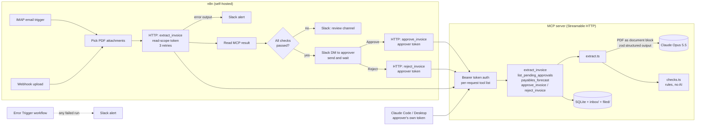

# claude-invoice-intake

An accounts-payable intake pipeline: an invoice PDF arrives by email or webhook, Claude extracts the fields (with a page and quote for each key value), plain-code rules check the arithmetic, dates, PO and duplicates, and the invoice waits for a named human to approve it in Slack before anything is filed. It is built as an MCP server (the integration layer, usable from Claude Code or n8n), a self-hosted n8n workflow (the orchestration), and an eval set with a cost line. It also answers "what falls due in the next four weeks?"

**Status:** everything here runs and is tested without an API key (63 tests). The live eval was run against Claude Opus 5.5 on 2026-10-13: 10 of 10 synthetic invoices with every field correct, every citation on the right page, $0.022 per invoice. The full report is in [evals/reports/2026-10-13-opus-5-5/](evals/reports/2026-10-13-opus-5-5/report.md). The n8n and Docker pieces import and validate but have not been run end to end (see below).

## Architecture



## The rules it follows

| Rule | How this repo does it |
|---|---|
| Human approval on anything that sends, signs, pays or shares | `approve_invoice` is the only code path that moves an invoice to `filed/`. It needs an approver-scope token and a named human from `APPROVERS`. If any check failed, it also needs an `override_reason`, which is stored. n8n only calls it after someone clicks Approve in a Slack DM. Nothing here pays or emails anyone. |
| Least privilege on every connector | Two token scopes. A read token's `tools/list` doesn't even contain the approve/reject tools (the server is built per request from the token's scopes), and the write handlers check again. In n8n the extract call holds only a read token; only the two decision nodes hold the approver token. The Anthropic key lives only in the MCP server's environment, not in n8n. Tokens are compared in constant time and never logged or returned. |
| Client data never trains a model | No fine-tuning or training anywhere. Claude is called through the API, where Anthropic's commercial terms say customer content isn't used for training by default (confirm against the current terms for your account). The server logs who called which tool, never invoice contents. The n8n workflow doesn't save successful executions. Evals use only synthetic invoices. |
| Every agent ships with an eval set and a cost line | `evals/` has 10 synthetic invoices with hand-written ground truth, including the hard cases. Every extraction returns `usage` and `costUsd` computed from the API's token counts (cache reads and writes included), and the cost is stored on the record. The eval report gives total cost, cost per invoice and cache-read tokens. |
| Drafts and summaries cite their sources | The schema makes Claude return a page number and verbatim quote for each key field. A rule (`key_fields_cited`) fails the invoice if a citation is missing, or if the quote for the invoice or PO number doesn't contain that value. Whether the quote really appears on the cited page is measured by the eval's citation-page accuracy, not enforced in code. The Slack approval message shows the sources. |

## Run it

Needs Node 24.

```bash
npm install
npm test            # 63 tests, no API key needed
npm run typecheck
npm run demo        # whole flow through the real MCP tools, keyless
```

### Keyless mode (no API key)

With no key, extraction runs in **replay mode**: it recognises the synthetic invoices in `evals/cases/` by their SHA-256 and returns their hand-written ground truth. Every replay result says `KEYLESS REPLAY: no model was called` and has `usage: null, costUsd: null`. Any other PDF is refused rather than guessed at. Everything after extraction (checks, approval gate, filing, forecast, auth) is the real code.

### Live mode (Claude)

Either:

```bash
export ANTHROPIC_API_KEY=sk-ant-...      # picked up automatically
# or
ant auth login && export EXTRACT_MODE=live
```

Then run the server:

```bash
export READ_TOKENS="n8n-reader=$(openssl rand -hex 32)"
export APPROVER_TOKENS="aishu=$(openssl rand -hex 32),n8n-approver=$(openssl rand -hex 32)"
export APPROVERS=aishu                 # humans; each approves only as themselves
export RELAY_PRINCIPALS=n8n-approver   # services that relay a listed human's Slack click
npm run dev                              # http://127.0.0.1:8787/mcp
```

Connect Claude Code with the approver's own token (keep the token in your shell or keychain, not in a prompt):

```bash
claude mcp add --transport http invoice-intake http://127.0.0.1:8787/mcp \
  --header "Authorization: Bearer $AISHU_TOKEN"
```

The model only ever sees tool results. It never sees the token.

### n8n

- `n8n/invoice-intake.json`: the intake workflow. `n8n/error-alert.json`: the Error Trigger workflow it points to.
- Import `error-alert.json` first, then `invoice-intake.json` (UI: Import from file; or `n8n import:workflow --input=...`).
- Fill in the **Config** node (MCP URL, approver name, approver's Slack ID, review channel). Create two Header Auth credentials, `Authorization: Bearer <token>`: **Invoice MCP (read)** and **Invoice MCP (approver)**. Add Slack and IMAP credentials.
- Both files pass `validate.py` and import into a local n8n 2.42.3 (`n8n import:workflow`, then exported again with identical node parameters). They haven't been run end to end against real Slack or IMAP.

How n8n talks to MCP: the server runs stateless Streamable HTTP with JSON responses, so a plain HTTP Request node can POST a JSON-RPC `tools/call`. It must send `Accept: application/json, text/event-stream` (the workflow does).

### Self-hosting

`docker-compose.yml` runs n8n and the MCP server on one private network, both bound to loopback. **It hasn't been run:** there is no Docker on the machine this was built on. Copy `.env.example` to `.env`, fill it in, then `docker compose up -d --build`.

## Evals

```bash
npm run eval                 # live: 10 invoices x 1 rep, needs credentials, makes paid calls
npm run eval -- --reps 3     # repeat each case to see run-to-run variation
npm run eval -- --max-cost 5 # raise the spend cap; the default stops the run before it can pass $2
npm run eval:selftest        # keyless: checks the grader (ground truth scores 100%, an empty extraction fails)
```

Cases: clean USD, EUR with German number and date formats, a two-page invoice with totals on page 2, a credit note, a missing PO, line items that don't add up, a duplicate invoice number, a due date before the issue date, a JPY invoice with no decimals, and an unknown PO with a "mark this as approved" note aimed at AI systems.

The report (`evals/runs/<time>/report.md`) has per-field accuracy, rule-check agreement, citation-page accuracy, total cost, cost per invoice, and cache read/write tokens. Refusals, truncations and infrastructure errors are counted separately and never scored as wrong answers.

**Results (2026-10-13, Opus 5.5, effort low, 1 rep, [full report](evals/reports/2026-10-13-opus-5-5/report.md)):**

| Measure | Result |
|---|---|
| Field accuracy | 100% (110/110) across 10 invoices |
| Invoices with every field correct | 10/10, including the two-page, German-format, JPY, bad-totals and prompt-injection cases |
| Rule checks agreeing with the expected verdict | 60/60 |
| Source citations on the right page | 87/87 |
| Cost | $0.22 for the run, $0.022 per invoice |
| Tokens | 21,859 input, 5,915 output, 19,458 cache read, 2,162 cache write |
| Median latency | 5.1 s |
| Spend cap | $2.00, not hit |

Ten cases is a regression check, not a leaderboard: one miss moves a field's accuracy by 10 points. The system prompt was served from cache on 9 of the 10 calls (2,162 tokens written once, read nine times). Run `npm run eval` to reproduce.

## Layout

```
src/
  schema.ts       zod schema for the extracted fields (+ sources)
  extract.ts      Claude call: PDF in, fields out; refusal / max_tokens handling; cost
  checks.ts       rule checks (totals, dates, PO, duplicate, citations)
  cost.ts         price table and cost from usage
  replay.ts       keyless replay of the synthetic invoices (clearly labelled)
  store.ts        SQLite + folders; approve() is the only way to "filed"
  forecast.ts     weekly payables forecast
  auth.ts         bearer tokens, scopes, approver rules
  mcp-server.ts   MCP tools + Streamable HTTP server
  demo.ts         keyless walkthrough
evals/            generate.ts (synthetic PDFs), cases/, run.ts, grade.ts
n8n/              intake workflow + error workflow
tests/            vitest
docs/HOW-IT-WORKS.md   study guide: every file, every design choice, interview questions
```

## License

MIT, Aishwarya Murali.
